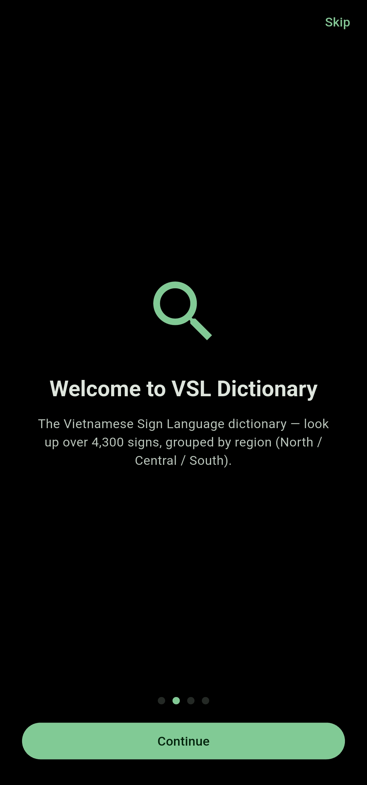
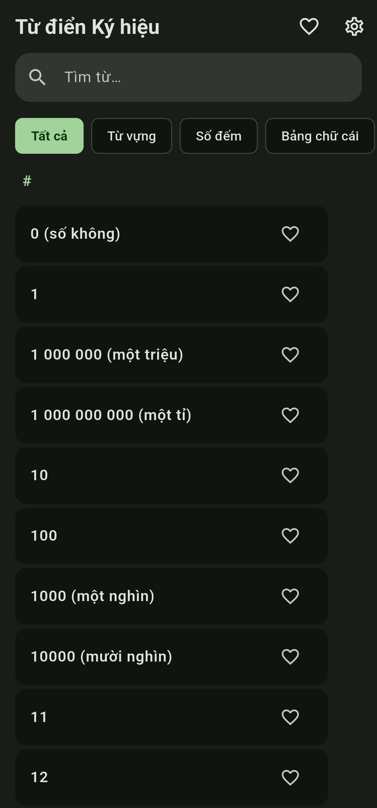
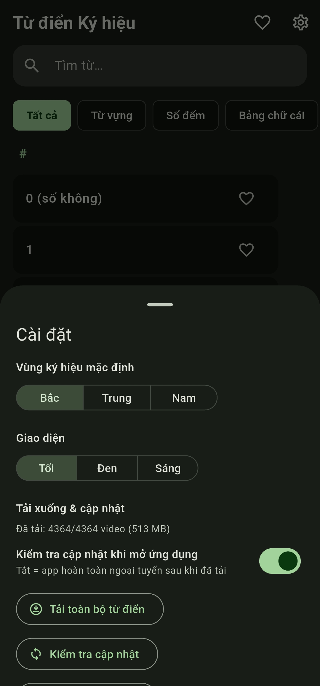
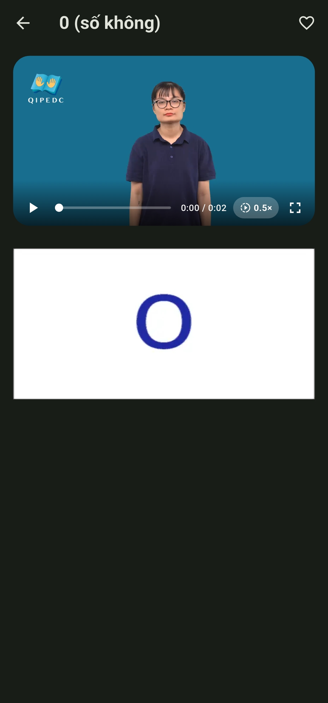
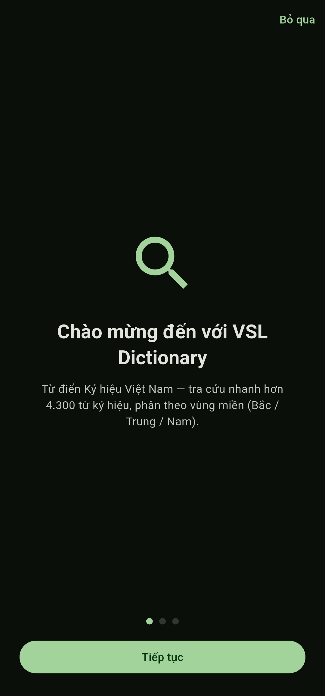

# VSL Dictionary — Từ điển Ký hiệu Việt Nam

**English** | [Tiếng Việt](README.vi.md)

[](https://github.com/ngozz/vsl-dictionary/actions/workflows/build.yml)
[](LICENSE)
[](https://github.com/ngozz/vsl-dictionary/releases)
<!-- F-Droid: [](https://f-droid.org/packages/com.ngozz.vsl_dictionary/) -->

A fast, offline-first Flutter app for browsing the Vietnamese Sign Language
dictionary. Video-first, search-first, no fluff. Interface in Vietnamese,
English or Mixed.

**Source data:** dictionary content transcribed from the National Sign
Language Dictionary at [qipedc.moet.gov.vn/dictionary](https://qipedc.moet.gov.vn/dictionary).

## Languages

- **Interface:** Vietnamese, English, or **Mixed** (English headwords with
  the Vietnamese word underneath) — Settings → Language, also asked on first
  launch.
- **Content:** the dictionary itself is **Vietnamese** — headwords,
  definitions and the sign videos are the original data. English glosses and
  definitions are a translated companion layer shown alongside them.
- **Search** follows the interface: Vietnamese-only in Vietnamese, English
  glosses in English, and both languages merged (best match first) in Mixed.
- *Translation note:* English text was translated with AI assistance and
  partially reviewed by hand. Some entries may still read awkwardly —
  corrections are very welcome via issues.

## Install

- **Android:** latest APKs from
  [Releases](https://github.com/ngozz/vsl-dictionary/releases):
  - `vsl-dictionary-android.apk` — lite (~83 MB), streams sign videos from
    the CDN, downloads them in-app for offline use
  - `vsl-dictionary-android-full.apk` — full (~600 MB), everything bundled,
    works fully offline out of the box
- **Web:** <https://ngozz.github.io/vsl-dictionary/> (always the lite build —
  videos stream from the CDN)
- **iOS** (unsigned IPA): add to SideStore/AltStore with the source below.
  Two entries are offered: `VSL Dictionary` (lite, CDN) and
  `VSL Dictionary Full` (all videos bundled). They install side by side
  because the full build uses `com.ngozz.vslDictionary.full`.

## Screenshots

English UI:

<p align="center">
  <a href="ss/1.jpg"></a>&nbsp;<a href="ss/2.jpg"></a>&nbsp;<a href="ss/3.jpg"></a>&nbsp;<a href="ss/4.jpg"></a>
</p>

Vietnamese UI:

<p align="center">
  <a href="ss/1_vn.jpg"></a>&nbsp;<a href="ss/2_vn.jpg"></a>&nbsp;<a href="ss/3_vn.jpg"></a>&nbsp;<a href="ss/4_vn.jpg"></a>
</p>

*Click a screenshot to open it full size.*

## What it does

- **Search-first** home: instant accent-insensitive search — type "cho" and
  find "chó" — with prefix/syllable-aware ranking and match highlighting,
  over 4,300 signs. In English or Mixed mode the English glosses are
  searchable too.
- **Browse tabs** — All (alphabetically grouped with an A–Z jump rail and
  draggable scrollbar), Words, Numbers, Alphabet. Sorted by the headword of
  the current interface language.
- **Word screen** — sign video (H.264, silent by design), per-region variants
  (North / Central / South) if available, 0.5× slow-mo, fullscreen playback,
  definition and illustration images.
- **English content** — English gloss and definition on every translated
  entry; the English headword leads in English/Mixed mode, with the
  Vietnamese word kept underneath in Mixed.
- **Personal touches** — favorites, default region preference, three themes
  (dark / pure-black AMOLED / light, green-seeded Material 3).
- **Fully offline capable** — sign videos stream from the CDN by default
  (`lite` flavor, ~83 MB APK) and can be downloaded in-app for a fully
  offline library; the `full` flavor (~600 MB) bundles everything instead.

## Project layout

```
vsl-dictionary/
├── data/
│   ├── vsl_data.json     # dictionary index (id, word, type, description…)
│   ├── i18n/en/          # English sidecar (glosses + definitions)
│   ├── videos/           # 4,364 re-encoded sign videos (H.264 mp4, no audio)
│   └── images/           # 1,840 illustrations (WebP q80)
├── lib/
│   ├── main.dart         # app entry + Material You themes
│   ├── models/word.dart  # data model
│   ├── services/         # dictionary search, media resolution, settings
│   └── screens/          # home (search/browse) + word detail
├── ss/                   # screenshots used in this README (English + Vietnamese UI)
├── .github/workflows/    # build + release CI (see below)
└── icon.png              # launcher icon source
```

The `_sources/` folder (not included here) holds the original Unity project.
Data is mine: video files are re-encoded to H.264 mp4, images to WebP.

## Building

```bash
flutter pub get
flutter run                          # run on a device (lite flavor)
flutter build apk --release          # Android, lite (default flavor)
flutter build apk --release --flavor full   # Android, all videos bundled
flutter build web --release          # Web → build/web (always lite)
flutter build ios --no-codesign --flavor lite  # iOS (needs Xcode + macOS)
flutter run --flavor full            # run the full (bundled) variant
flutter build ios --no-codesign --flavor full  # iOS with bundled videos
```

## CI/CD (GitHub Actions)

`.github/workflows/build.yml` builds and publishes automatically. Triggers:

| Trigger | Effect |
|---|---|
| Push commit whose **message contains `[build]`** | Builds **both variants**: Android APK + unsigned iOS IPA + Web |
| **Manual** (`workflow_dispatch`) | Same, any time |
| Any other push | CI skipped on purpose |

Each build run **creates a GitHub Release** (`v<run-number>`) containing
**both variants**, built from the same commit:

- `vsl-dictionary-android.apk` — `lite` flavor: streams sign videos from the
  media host, downloads them in-app for offline use
- `vsl-dictionary-android-full.apk` — `full` flavor: all media bundled (~600 MB)
- `vsl-dictionary-ios-unsigned.ipa` — `lite` flavor; the SideStore/AltStore
  source points here
- `vsl-dictionary-ios-full-unsigned.ipa` — `full` flavor: all media bundled
- `vsl-dictionary-web.zip` — static web build (always lite, CDN only)

The web artifact is also **deployed to GitHub Pages** automatically on each
`main` build (base path is baked at build time so it works under
`/<repo>/`). The online app is available at
`https://ngozz.github.io/vsl-dictionary/`.

Thinking about Play Store or F-Droid? See [PUBLISHING.md](PUBLISHING.md).

## Build variants (Flutter flavors)

Both variants come from the same codebase. `lite` is the default flavor
(`default-flavor: lite` in `pubspec.yaml`); `full` additionally bundles
`data/videos/` because that asset directory is declared with
`flavors: [full]`. The flavor also drives `CdnConfig.useCdn`
(`appFlavor != 'full'`), so code and assets cannot drift apart.

| Flavor | Media | Android | iOS |
|---|---|---|---|
| `lite` (default) | streamed from the CDN, downloadable in-app | ~83 MB | ~36 MB |
| `full` | `data/videos/` bundled | ~600 MB | ~600 MB |

- **Web is always lite.** Web builds use the default flavor, so the full-only
  video assets are excluded and the Pages artifact is ~70 MB on disk
  (~40 MB zipped) instead of ~545 MB. Videos stream from the CDN; there is
  no bundled fallback.
- **Side-by-side installs.** Android `full` adds `applicationIdSuffix ".full"`
  and iOS `full` uses `com.ngozz.vslDictionary.full`, so it can live next to
  the lite app.
- **iOS schemes.** `ios/Runner.xcodeproj` has `Debug/Release/Profile-lite`
  and `-full` build configurations plus `lite.xcscheme`/`full.xcscheme`;
  `APP_DISPLAY_NAME` gives each app its own home-screen name.

Sign videos stream from `https://vsl-dictionary-media.ngozz.workers.dev`
(Cloudflare Workers static assets, free tier). Resolution order: bundled
asset (full only) → downloaded copy → CDN stream.

- **Download all** (Settings → Downloads & updates): ~513 MB into app
  storage with size+SHA-256 verification before promotion; re-running only
  enqueues the delta.
- **Update check**: at startup (toggleable) or manually — compares manifest
  sizes against local copies and prompts before re-downloading anything.

The iOS builds can be installed with SideStore or AltStore using this source:
`https://ngozz.github.io/vsl-dictionary/altstore-source.json`. It lists both
the **lite** unsigned IPA (offline comes from in-app downloads) and the
**full** unsigned IPA (everything bundled); SideStore/AltStore signs them
during installation.

### Repo setup notes

1. Enable **Actions → Settings → Pages → GitHub Pages** with the workflow
   source set (the `deploy-pages` job configures this).
2. Media (~540 MB) makes the repo big; consider
   [`git lfs`](https://git-lfs.com) for `data/videos/*` if you hit push
   limits — or keep media out of git and fetch it from your CDN in a later
   iteration (the media service is designed to swap prefixes to URLs). Note
   that F-Droid's build server clones the whole repo, so slimming this down
   matters before submitting there (see [PUBLISHING.md](PUBLISHING.md)).
3. iOS builds need no extra setup (no signing config = unsigned IPA on a
   macOS runner).

## Data attribution

Dictionary contents sourced from the
[Việt Nam Dictionary of Sign Language](https://qipedc.moet.gov.vn/dictionary)
(Trung tâm Ký hiệu Việt Nam / Bộ Giáo dục và Đào tạo). This project is a
personal-use reader, not the original work.

## License

[MIT](LICENSE) — the dictionary content itself belongs to its original
publishers (see attribution above).
