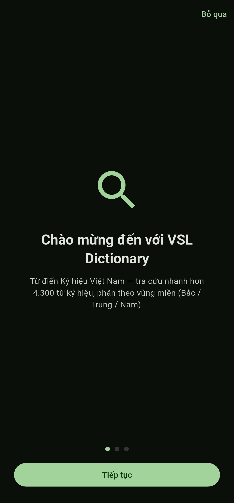
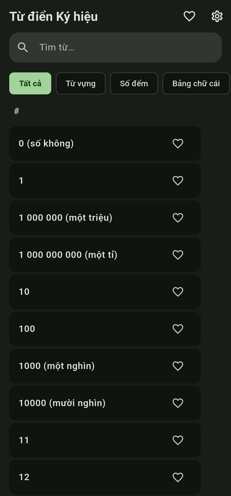
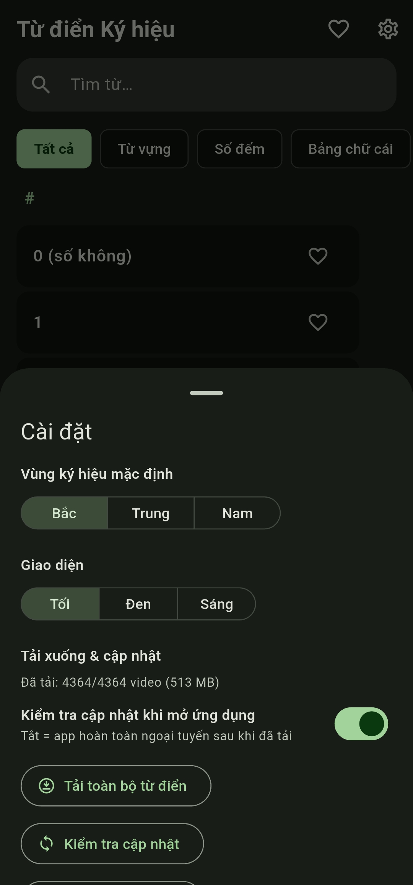
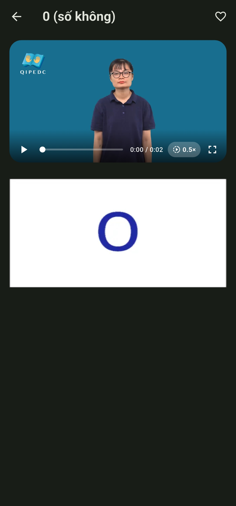
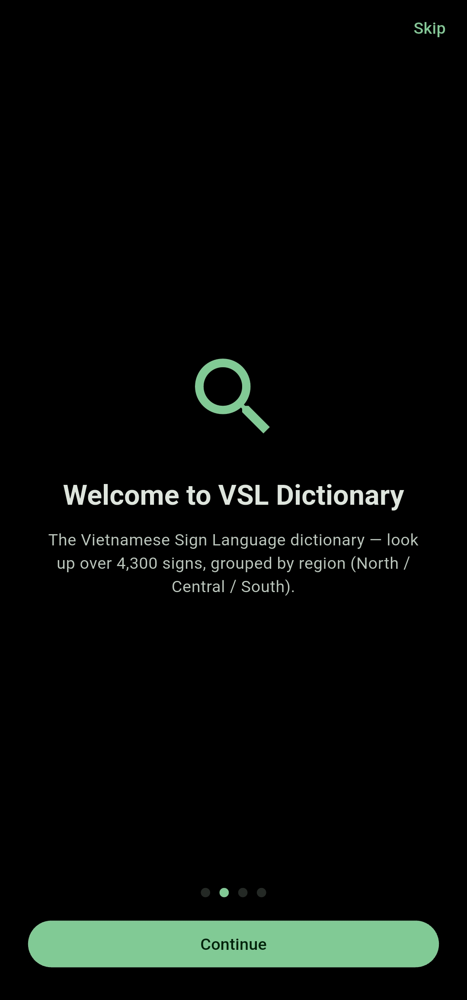

# VSL Dictionary — Từ điển Ký hiệu Việt Nam

[English](README.md) | **Tiếng Việt**

[](https://github.com/ngozz/vsl-dictionary/actions/workflows/build.yml)
[](LICENSE)
[](https://github.com/ngozz/vsl-dictionary/releases)
<!-- F-Droid: [](https://f-droid.org/packages/com.ngozz.vsl_dictionary/) -->

Ứng dụng Flutter nhanh, ưu tiên offline để tra cứu Từ điển Ký hiệu Việt Nam.
Video là chính, tìm kiếm là chính, không rườm rà. Giao diện tiếng Việt,
tiếng Anh hoặc Kết hợp.

**Nguồn dữ liệu:** nội dung từ điển được chuyển thể từ Từ điển Ngôn ngữ ký
hiệu quốc gia tại [qipedc.moet.gov.vn/dictionary](https://qipedc.moet.gov.vn/dictionary).

## Ngôn ngữ

- **Giao diện:** tiếng Việt, tiếng Anh hoặc **Kết hợp** (từ tiếng Anh làm
  chính, kèm tiếng Việt bên dưới) — Cài đặt → Ngôn ngữ, cũng được hỏi khi mở
  ứng dụng lần đầu.
- **Nội dung:** bản thân từ điển là **tiếng Việt** — từ khóa, nghĩa và video
  dấu là dữ liệu gốc. Nghĩa và định nghĩa tiếng Anh là lớp dịch đi kèm, hiển
  thị cùng với bản gốc.
- **Tìm kiếm** theo giao diện: chỉ tiếng Việt ở chế độ Việt, gloss tiếng Anh
  ở chế độ Anh, và gộp cả hai (khớp tốt nhất lên đầu) ở chế độ Kết hợp.
- *Ghi chú về bản dịch:* phần tiếng Anh được dịch với sự hỗ trợ của AI và
  được người thật soát một phần. Một số mục vẫn có thể hơi gượng — rất mong
  nhận được sửa lỗi qua issues.

## Cài đặt

- **Android:** APK mới nhất tại
  [Releases](https://github.com/ngozz/vsl-dictionary/releases):
  - `vsl-dictionary-android.apk` — lite (~83 MB), video dấu phát từ CDN, tải
    về trong ứng dụng để dùng offline
  - `vsl-dictionary-android-full.apk` — full (~600 MB), kèm toàn bộ media,
    offline hoàn toàn ngay khi cài
- **Web:** <https://ngozz.github.io/vsl-dictionary/> (luôn là bản lite —
  video phát từ CDN)
- **iOS** (IPA chưa ký): thêm vào SideStore/AltStore bằng nguồn bên dưới.
  Có hai mục: `VSL Dictionary` (lite, CDN) và `VSL Dictionary Full` (kèm
  toàn bộ video). Hai bản cài song song được vì bản full dùng
  `com.ngozz.vslDictionary.full`.

## Ảnh minh họa

Giao diện tiếng Việt:

<p align="center">
  <a href="ss/1_vn.jpg"></a>&nbsp;<a href="ss/2_vn.jpg"></a>&nbsp;<a href="ss/3_vn.jpg"></a>&nbsp;<a href="ss/4_vn.jpg"></a>
</p>

Giao diện tiếng Anh:

<p align="center">
  <a href="ss/1.jpg"></a>&nbsp;<a href="ss/2.jpg"></a>&nbsp;<a href="ss/3.jpg"></a>&nbsp;<a href="ss/4.jpg"></a>
</p>

*Chạm vào ảnh để xem kích thước đầy đủ.*

## Tính năng

- **Trang chủ tìm-trước**: tìm kiếm tức thì không phân biệt dấu — gõ "cho"
  vẫn ra "chó" — xếp hạng theo tiền tố/âm tiết và đánh dấu khớp, trên hơn
  4.300 dấu. Ở chế độ English hoặc Kết hợp, gloss tiếng Anh cũng được tìm.
- **Tab duyệt** — Tất cả (nhóm theo bảng chữ cái, có thanh nhảy A-Z và
  scrollbar kéo được), Từ vựng, Số đếm, Bảng chữ cái. Sắp xếp theo từ hiển thị
  của ngôn ngữ giao diện hiện tại.
- **Trang từ** — video dấu (H.264, không tiếng theo thiết kế), biến thể theo
  vùng (Bắc / Trung / Nam) nếu có, xem chậm 0.5×, toàn màn hình, nghĩa và ảnh
  minh họa.
- **Nội dung tiếng Anh** — gloss và định nghĩa tiếng Anh trên mọi mục đã
  dịch; từ tiếng Anh làm chính ở chế độ English/Kết hợp, kèm tiếng Việt bên
  dưới ở chế độ Kết hợp.
- **Cá nhân hóa** — yêu thích, vùng mặc định, ba giao diện (tối / đen hoàn
  toàn AMOLED / sáng, Material 3 xanh lá).
- **Offline hoàn toàn** — video dấu phát từ CDN theo mặc định (flavor `lite`,
  APK ~83 MB) và có thể tải về trong ứng dụng để có thư viện offline đầy đủ;
  flavor `full` (~600 MB) kèm sẵn toàn bộ.

## Cấu trúc dự án

```
vsl-dictionary/
├── data/
│   ├── vsl_data.json     # danh mục từ điển (id, word, type, description…)
│   ├── i18n/en/          # sidecar tiếng Anh (gloss + định nghĩa)
│   ├── videos/           # 4.364 video dấu đã encode lại (H.264 mp4, không âm thanh)
│   └── images/           # 1.840 ảnh minh họa (WebP q80)
├── lib/
│   ├── main.dart         # điểm vào app + theme Material You
│   ├── models/word.dart  # data model
│   ├── services/         # tìm kiếm, xử lý media, cài đặt
│   └── screens/          # home (tìm kiếm/duyệt) + trang từ
├── ss/                   # ảnh chụp dùng trong README này (giao diện Việt + Anh)
├── .github/workflows/    # CI build + release (xem bên dưới)
└── icon.png              # nguồn icon launcher
```

Thư mục `_sources/` (không kèm theo đây) chứa dự án Unity gốc. Phần dữ liệu
do tôi thực hiện: video được encode lại thành H.264 mp4, ảnh thành WebP.

## Build

```bash
flutter pub get
flutter run                          # chạy trên thiết bị (flavor lite)
flutter build apk --release          # Android, lite (flavor mặc định)
flutter build apk --release --flavor full   # Android, kèm toàn bộ video
flutter build web --release          # Web → build/web (luôn lite)
flutter build ios --no-codesign --flavor lite  # iOS (cần Xcode + macOS)
flutter build ios --no-codesign --flavor full  # iOS kèm video
```

## CI/CD (GitHub Actions)

`.github/workflows/build.yml` build và publish tự động. Trigger:

| Trigger | Kết quả |
|---|---|
| Commit có **tin nhắn chứa `[build]`** | Build **cả hai biến thể**: Android APK + iOS IPA chưa ký + Web |
| **Thủ công** (`workflow_dispatch`) | Như trên, bất cứ lúc nào |
| Push khác | CI được bỏ qua có chủ đích |

Mỗi lần build **tạo một GitHub Release** (`v<số-run>`) chứa **cả hai biến
thể**, build từ cùng một commit:

- `vsl-dictionary-android.apk` — flavor `lite`: video dấu phát từ media host,
  tải về trong ứng dụng để dùng offline
- `vsl-dictionary-android-full.apk` — flavor `full`: kèm toàn bộ media (~600 MB)
- `vsl-dictionary-ios-unsigned.ipa` — flavor `lite`; nguồn SideStore/AltStore
  trỏ tới file này
- `vsl-dictionary-ios-full-unsigned.ipa` — flavor `full`: kèm toàn bộ media
- `vsl-dictionary-web.zip` — bản web tĩnh (luôn lite, chỉ dùng CDN)

Bản web cũng được **triển khai lên GitHub Pages** tự động mỗi lần build
`main` (base path được ném vào lúc build nên chạy được dưới `/<repo>/`).
Ứng dụng online tại `https://ngozz.github.io/vsl-dictionary/`.

Muốn đưa lên Play Store hay F-Droid? Xem [PUBLISHING.md](PUBLISHING.md).

## Biến thể build (Flutter flavor)

Cả hai biến thể dùng chung mã nguồn. `lite` là flavor mặc định
(`default-flavor: lite` trong `pubspec.yaml`); `full` kèm thêm `data/videos/`
vì thư mục asset đó được khai báo `flavors: [full]`. Flavor cũng điều khiển
`CdnConfig.useCdn` (`appFlavor != 'full'`), nên code và asset không thể lệch
nhau.

| Flavor | Media | Android | iOS |
|---|---|---|---|
| `lite` (mặc định) | phát từ CDN, tải về trong ứng dụng | ~83 MB | ~36 MB |
| `full` | kèm `data/videos/` | ~600 MB | ~600 MB |

- **Web luôn là lite.** Web build dùng flavor mặc định, nên asset riêng của
  bản full bị loại và artifact Pages chỉ còn ~70 MB trên đĩa (~40 MB khi
  nén) thay vì ~545 MB. Video phát từ CDN; không còn bản kèm dự phòng.
- **Cài song song.** Android `full` thêm `applicationIdSuffix ".full"` và iOS
  `full` dùng `com.ngozz.vslDictionary.full`, nên cài cạnh bản lite được.
- **Scheme iOS.** `ios/Runner.xcodeproj` có cấu hình build
  `Debug/Release/Profile-lite` và `-full` cùng `lite.xcscheme`/`full.xcscheme`;
  `APP_DISPLAY_NAME` đặt tên riêng cho từng app trên màn hình chính.

Video dấu phát từ `https://vsl-dictionary-media.ngozz.workers.dev`
(Cloudflare Workers static assets, free tier). Thứ tự ưu tiên: asset kèm sẵn
(chỉ bản full) → bản đã tải → CDN.

- **Tải tất cả** (Cài đặt → Tải xuống & cập nhật): ~513 MB vào bộ nhớ ứng
  dụng, kiểm tra kích thước + SHA-256 trước khi kích hoạt; chạy lại chỉ
  enqueue phần chênh lệch.
- **Kiểm tra cập nhật**: khi mở ứng dụng (có thể tắt) hoặc thủ công — so
  kích thước manifest với bản local và hỏi trước khi tải lại bất cứ thứ gì.

Bản iOS có thể cài bằng SideStore hoặc AltStore với nguồn này:
`https://ngozz.github.io/vsl-dictionary/altstore-source.json`. Nguồn liệt kê
cả IPA **lite** chưa ký (offline đến từ tải trong ứng dụng) và IPA **full**
chưa ký (kèm mọi thứ); SideStore/AltStore ký khi cài.

### Ghi chú setup repo

1. Bật **Actions → Settings → Pages → GitHub Pages** với nguồn là workflow
   (job `deploy-pages` tự cấu hình việc này).
2. Media (~540 MB) làm repo nặng; cân nhắc [`git lfs`](https://git-lfs.com)
   cho `data/videos/*` nếu gặp giới hạn push — hoặc bỏ media khỏi git và
   lấy từ CDN ở vòng sau (media service được thiết kế để đổi prefix sang
   URL). Lưu ý: máy build của F-Droid clone cả repo nên cần làm gọn trước
   khi gửi (xem [PUBLISHING.md](PUBLISHING.md)).
3. Build iOS không cần setup thêm (không có cấu hình ký = IPA chưa ký trên
   macOS runner).

## Ghi công dữ liệu

Nội dung từ điển lấy từ
[Việt Nam Dictionary of Sign Language](https://qipedc.moet.gov.vn/dictionary)
(Trung tâm Ký hiệu Việt Nam / Bộ Giáo dục và Đào tạo). Dự án này là trình đọc
dùng cá nhân, không phải sản phẩm gốc.

## Giấy phép

[MIT](LICENSE) — nội dung từ điển thuộc về nhà xuất bản gốc của nó (xem ghi
công ở trên).
